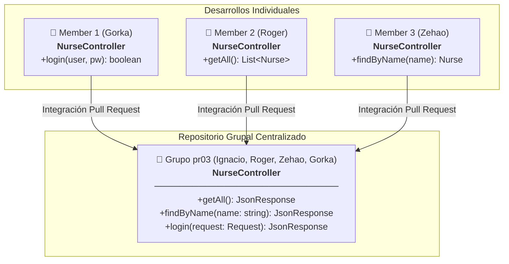
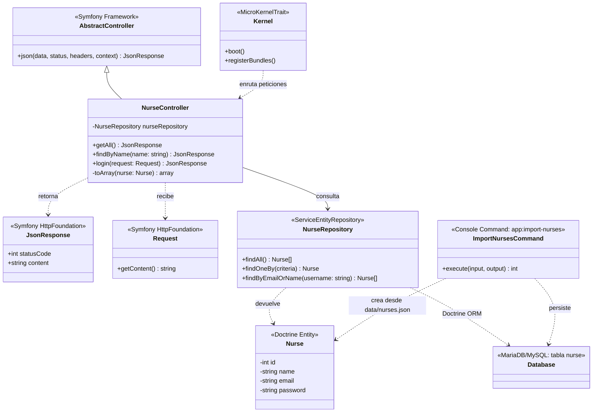
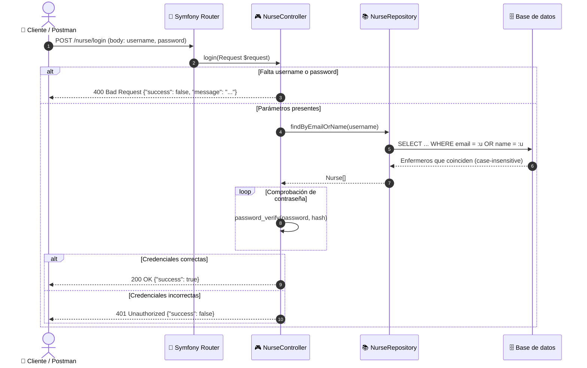
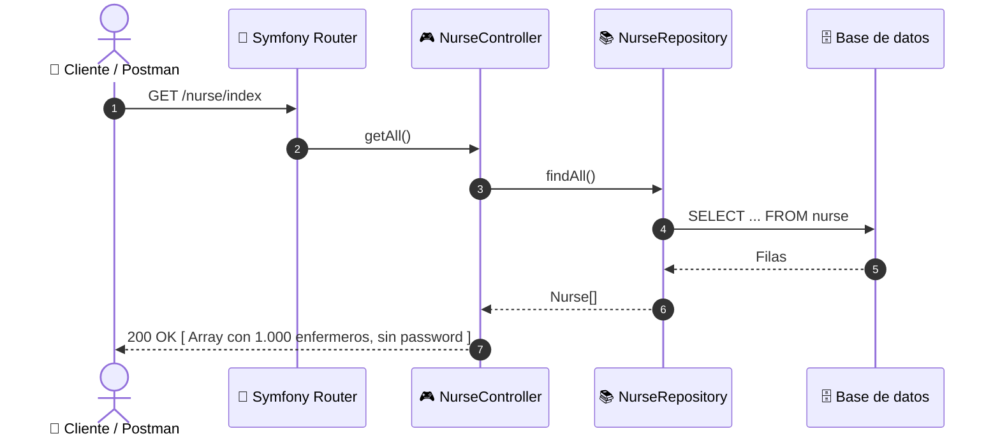
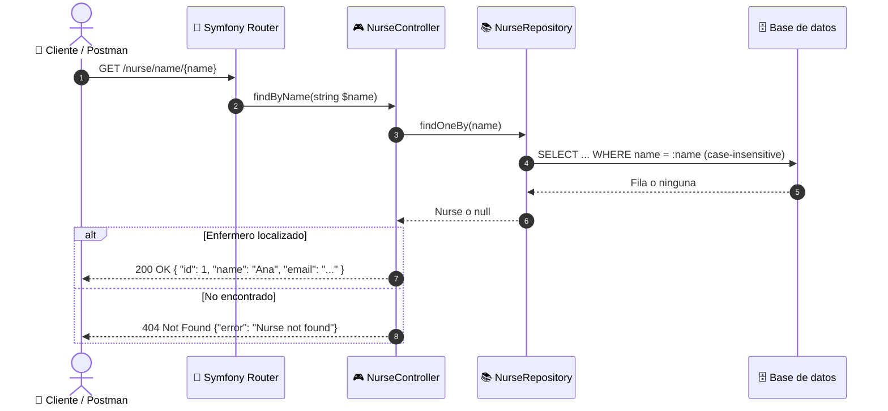
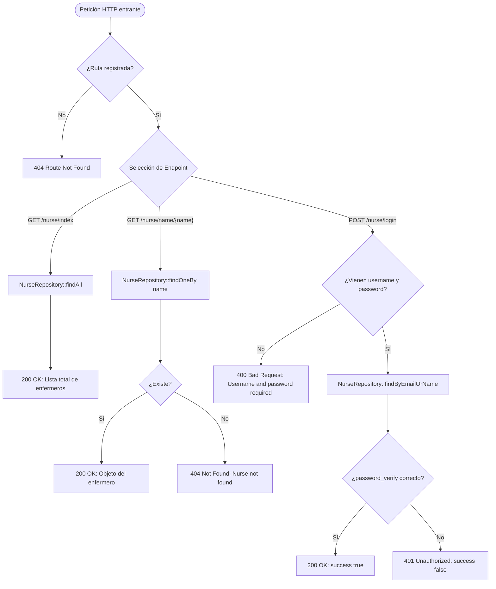

<div align="center">

# 🏥 Nurse Simulator

[](https://symfony.com/)
[](https://www.php.net/)
[-E2001A?style=for-the-badge)](https://www.stucom.com/)
[](#)
[](LICENSE)

<p align="center">
  <strong>API REST de Simulación y Gestión Hospitalaria de Personal de Enfermería</strong><br>
  M0616 — Proyecto Intermodular | 2º Desarrollo de Aplicaciones Web (DAW)
</p>

[🇪🇸 Documentación Completa (ES)](docs/general/DOCUMENTACION_ES.md) • [🇬🇧 Full Documentation (EN)](docs/general/DOCUMENTATION_EN.md) • [Colección Postman](docs/postman/nurse-api.postman_collection.json)

---

</div>

## 📖 1. Sobre el Proyecto

**Nurse Simulator** es una API REST desarrollada con **Symfony 7.4** y **PHP 8.2+** orientada a simular la administración, consulta e identificación de los enfermeros de un complejo hospitalario.

Este proyecto forma parte de la fase inicial (**pr03 — Introducción Backend**) del **Proyecto Intermodular (M0616)** cursado en **2º DAW** en el centro **STUCOM Pelai (Barcelona)** durante el curso académico **2026/2027**.

### 👥 Equipo de Desarrollo y Roles (Grupo pr03)

| Miembro | Rol y Responsabilidades | GitHub |
|---|---|---|
| **Ignacio Breñas** | **Project Manager & Tech Lead**<br>• Dirección y organización integral del equipo de desarrollo.<br>• Creación y estructuración de las ramas de trabajo individuales de cada miembro.<br>• Definición, reparto y seguimiento de Issues en el tablero de GitHub Projects.<br>• Supervisión de calidad, revisión e integración de Pull Requests asegurando el correcto funcionamiento global.<br>• Inicialización del framework Symfony 7.4 y centralización de la suite de pruebas en Postman. | [@Ignaciobrenas](https://github.com/Ignaciobrenas) |
| **Christopher Roger Tito** | **Desarrollador Backend**<br>• Implementación del endpoint de lectura general de enfermeros (`getAll`).<br>• Pruebas y evidencias en Postman para el listado global. | [@RogerTito455](https://github.com/RogerTito455) |
| **Zehao Yin** | **Desarrollador Backend**<br>• Implementación del endpoint de búsqueda por nombre (`findByName`).<br>• Ampliación del dataset de pruebas a 1.000 enfermeros en JSON. | [@zyin-08](https://github.com/zyin-08) |
| **Gorka Ramirez** | **Desarrollador Backend**<br>• Implementación del endpoint de validación y login de enfermeros (`login`).<br>• Pruebas unitarias de credenciales y evidencias en Postman. | [@gorkaramirez936](https://github.com/gorkaramirez936) |

---

## 🎯 2. Objetivos de la Práctica (STUCOM pr03)

Siguiendo las especificaciones del documento oficial docente (`pr03_Introduccio_back_end`):
1. **Aprendizaje y bases del trabajo grupal con Symfony:** Creación de proyecto modular e integración progresiva de ramas de trabajo en equipo.
2. **Desarrollo de API REST estática:** Exposición de endpoints HTTP que devuelven respuestas en formato JSON a partir de datos estructurados en archivos (simulando persistencia previa a la introducción de bases de datos relacionales).
3. **Flujo de trabajo individual a grupal:**
   - Desarrollo individual de endpoints especializados por cada miembro.
   - Fusión e integración coordinada en un repositorio común (`group repo`).
4. **Verificación exhaustiva:** Chequeo funcional de cada endpoint mediante **Postman** y registro de evidencias.

---

## 🏗️ 3. Arquitectura y Esquemas UML

### 3.1. Esquema de Integración Modular (Trabajo Individual ➡️ Repositorio Común)

Tal y como especifica la práctica, cada integrante del equipo desarrolló su funcionalidad antes de confluir en el controlador grupal integrado:



---

### 3.2. Diagrama de Clases UML



---

### 3.3. Diagramas de Secuencia

#### A. Inicio de Sesión (`POST /nurse/login`)


#### B. Consulta General (`GET /nurse/index`)


#### C. Búsqueda por Nombre (`GET /nurse/name/{name}`)


---

### 3.4. Diagrama de Flujo Lógico de la Aplicación



---

## ⚡ 4. Especificación de la API REST

### Endpoints Disponibles

| Método | Ruta | Parámetros | Códigos HTTP | Descripción |
|---|---|---|---|---|
| `GET` | `/nurse/index` | *Ninguno* | `200` | Devuelve el catálogo completo de 1.000 enfermeros (`id`, `name`, `email`). |
| `GET` | `/nurse/name/{name}` | Path: `{name}` | `200`, `404` | Localiza un enfermero por su nombre (*case-insensitive*). No devuelve `password`. |
| `POST` | `/nurse/login` | Body JSON: `username`, `password` | `200`, `400`, `401` | Inicia sesión verificando credenciales contra email o nombre. |

### Colección de Pruebas Postman

El repositorio incluye la suite de pruebas lista para importar:
* 📄 [`docs/postman/nurse-api.postman_collection.json`](docs/postman/nurse-api.postman_collection.json)
* 📸 Evidencias de ejecución: [`docs/postman/login`](docs/postman/login), [`docs/postman/readAll`](docs/postman/readAll), [`docs/postman/readByName`](docs/postman/readByName).

---

## 💾 5. Modelo de Datos (tabla `nurse`)

Los datos se guardan en una base de datos **MariaDB/MySQL** gestionada con **Doctrine ORM**. La tabla se genera desde la entidad [`src/Entity/Nurse.php`](src/Entity/Nurse.php) mediante una migración:

```sql
CREATE TABLE nurse (
  id INT AUTO_INCREMENT NOT NULL,
  name VARCHAR(100) NOT NULL,
  email VARCHAR(180) NOT NULL,
  password VARCHAR(255) NOT NULL,
  UNIQUE INDEX uniq_nurse_email (email),
  PRIMARY KEY (id)
) DEFAULT CHARACTER SET utf8mb4 COLLATE utf8mb4_unicode_ci ENGINE = InnoDB
```

Los 1.000 enfermeros de prueba de [`data/nurses.json`](data/nurses.json) se cargan con `php bin/console app:import-nurses`.

> [!NOTE]
> Las contraseñas se guardan **cifradas con hash** (`password_hash`) y se comprueban con `password_verify`. La API nunca devuelve el campo `password`.

---

## 🔄 6. Flujo de Trabajo en GitHub

El equipo siguió una metodología estricta basada en ramas, issues y pull requests:


* **Gestión y Liderazgo:** Ignacio Breñas ejerció el rol de **Project Manager**, encargándose de planificar las entregas, estructurar y crear las ramas de trabajo de cada desarrollador, repartir los issues en GitHub Projects y supervisar la integración continua asegurando la estabilidad y el correcto funcionamiento de todo el proyecto.
* **Convención de commits:** `usuario/Tipo: descripción #issue` (ej. `roger/Feat: implement read all nurses from file #2`).
* **Tablero Kanban:** Gestión mediante GitHub Projects (`Todo`, `In progress`, `Done`).
* **Integración controlada:** Ramas individuales de feature ➡️ `staging` mediante Pull Request con revisión de código ➡️ `main` para versiones estables.

---

## 🚀 7. Instalación y Ejecución Rápida

### Requisitos Previos
* **PHP >= 8.2** con extensiones comunes (`json`, `mbstring`, `ctype`).
* **Composer** (v2 o superior).
* **MariaDB** o **MySQL** (por ejemplo, el de XAMPP).
* *(Opcional)* **Symfony CLI**.

### Puesta en Marcha

```bash
# 1. Clonar el repositorio
git clone https://github.com/Ignaciobrenas/Nurse-Simulator.git
cd Nurse-Simulator

# 2. Instalar dependencias de Symfony
composer install

# 3. Configurar entorno local
cp .env.example .env
# Añade DATABASE_URL en .env.local (no se sube a Git), por ejemplo para XAMPP:
# DATABASE_URL="mysql://root:@127.0.0.1:3306/nurse_simulator?serverVersion=10.4.32-MariaDB&charset=utf8mb4"

# 4. Crear la base de datos, la tabla y cargar los enfermeros
php bin/console doctrine:database:create
php bin/console doctrine:migrations:migrate
php bin/console app:import-nurses

# 5. Iniciar el servidor de desarrollo
symfony server:start
# O alternativamente con PHP CLI:
php -S localhost:8000 -t public
```

### Probar Endpoints con cURL

```bash
# Listado completo de enfermeros
curl -i http://localhost:8000/nurse/index

# Buscar enfermero por nombre
curl -i http://localhost:8000/nurse/name/Ana

# Iniciar sesión
curl -i -X POST http://localhost:8000/nurse/login \
  -H "Content-Type: application/json" \
  -d '{"username": "ana@hospital.com", "password": "ana123"}'
```

---

## 📂 8. Estructura del Proyecto

```
Nurse-Simulator/
├── bin/
│   └── console                    # CLI de Symfony
├── config/                        # Configuración de rutas y servicios
│   ├── packages/
│   ├── routes.yaml
│   └── services.yaml
├── data/
│   └── nurses.json                # Dataset inicial (1.000 enfermeros) para app:import-nurses
├── docs/
│   ├── general/
│   │   ├── DOCUMENTACION_ES.md    # Memoria técnica completa en español
│   │   ├── DOCUMENTATION_EN.md    # Complete technical documentation in English
│   │   ├── Nurse-Simulator.docx   # Documento Word editable
│   │   └── Nurse-Simulator_...pdf # Documento PDF oficial de entrega
│   └── postman/                   # Colección y capturas de prueba
│       ├── login/
│       ├── readAll/
│       ├── readByName/
│       └── nurse-api.postman_collection.json
├── migrations/                    # Migraciones de Doctrine (tabla nurse)
├── public/
│   └── index.php                  # Front Controller
├── src/
│   ├── Command/
│   │   └── ImportNursesCommand.php # Comando app:import-nurses
│   ├── Controller/
│   │   └── NurseController.php    # Controlador con todos los endpoints
│   ├── Entity/
│   │   └── Nurse.php              # Entidad Doctrine
│   ├── Repository/
│   │   └── NurseRepository.php    # Consultas de enfermeros
│   └── Kernel.php                 # Kernel de la aplicación
├── .env.example                   # Plantilla de variables de entorno
├── composer.json                  # Dependencias y autoloading
├── LICENSE                        # Licencia MIT
└── README.md                      # Presentación visual del proyecto
```

---

<div align="center">
  <sub>Desarrollado con dedicación por el Grupo pr03 • STUCOM Pelai • DAW 2 (2026/27)</sub>
</div>
