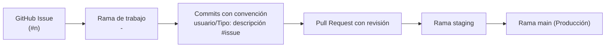
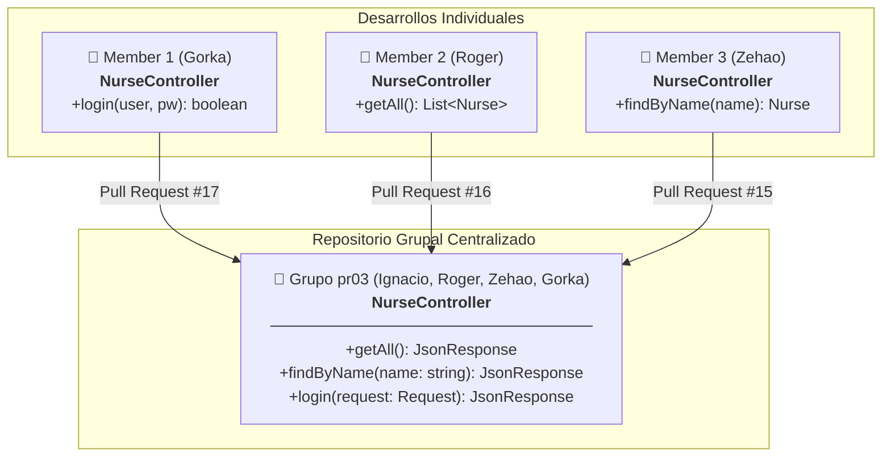
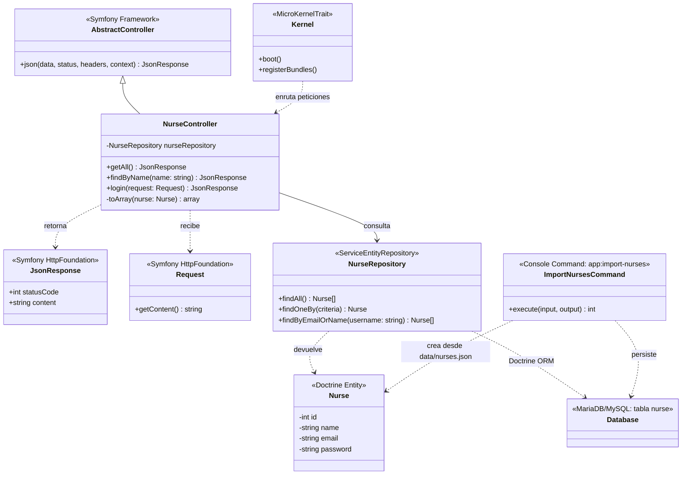
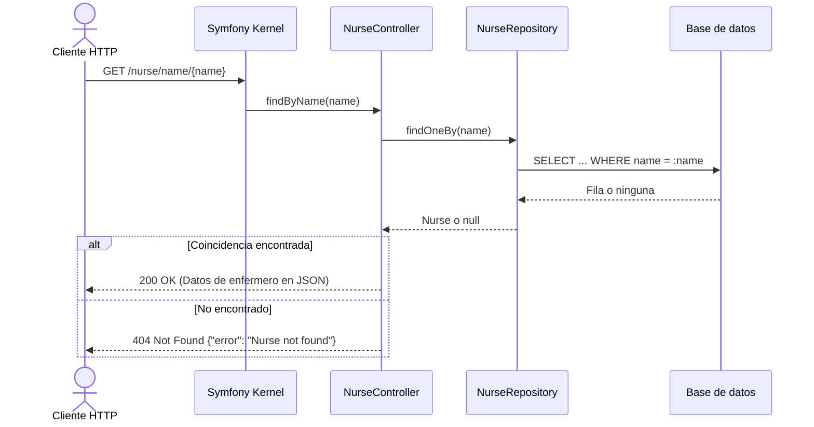
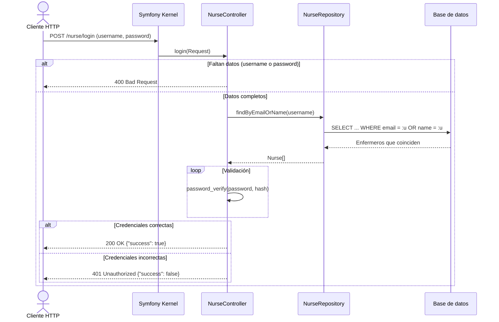
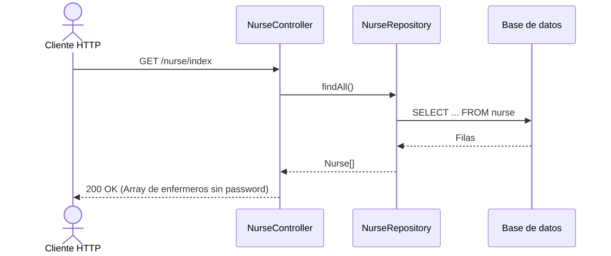
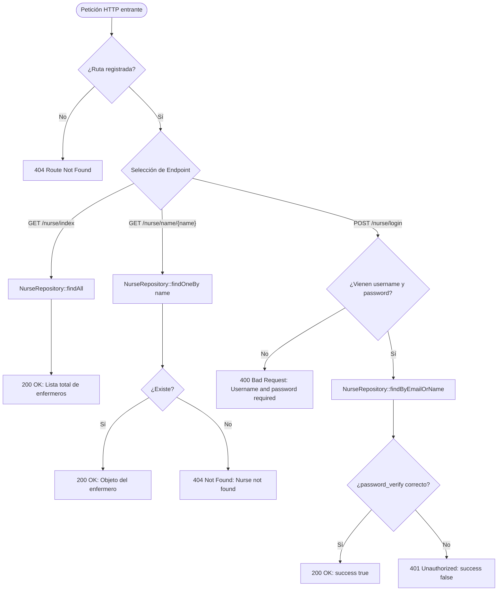

# Nurse Simulator — Documentación General del Proyecto

> **M0616 - Proyecto Intermodular | DAW 2 (Curso 2026/2027)**  
> **Centro:** STUCOM Pelai (Barcelona)  
> **Grupo:** pr03  
> **Autores:** Ignacio Breñas Muñoz, Christopher Roger Tito Farez, Zehao Yin, Gorka Ramirez  
> **Repositorio:** [https://github.com/Ignaciobrenas/Nurse-Simulator](https://github.com/Ignaciobrenas/Nurse-Simulator)

---

## 1. Resumen Ejecutivo y Equipo

**Nurse Simulator** es una API REST desarrollada con **Symfony 7.4** y **PHP 8.2+** cuyo objetivo es simular la gestión del personal de enfermería de un centro hospitalario. 

El proyecto está planteado como un trabajo académico en equipo, concebido para evolucionar incrementalmente a lo largo de diversas fases de desarrollo. La API expone servicios web esenciales para la consulta, filtrado e inicio de sesión de enfermeros/as. En la primera fase los datos se leían de un archivo JSON; en la segunda fase el almacenamiento se ha migrado a una base de datos relacional (MariaDB/MySQL) gestionada con **Doctrine ORM**.

### Equipo de Desarrollo y Roles

| Miembro | Rol | Responsabilidades |
|---|---|---|
| **Ignacio Breñas Muñoz** | **Project Manager & Tech Lead** | Organización global del equipo, creación de ramas individuales, reparto de issues en GitHub Projects, revisión de Pull Requests y aseguramiento de la estabilidad del proyecto. |
| **Christopher Roger Tito Farez** | **Backend Developer** | Implementación del endpoint `GET /nurse/index` y capturas de prueba. |
| **Zehao Yin** | **Backend Developer** | Implementación del endpoint `GET /nurse/name/{name}` y dataset de 1.000 enfermeros. |
| **Gorka Ramirez** | **Backend Developer** | Implementación del endpoint `POST /nurse/login` y verificación de credenciales. |

---

## 2. Arquitectura de Datos y Almacenamiento

La aplicación persiste y consulta la información en una base de datos relacional **MariaDB/MySQL** mediante **Doctrine ORM**:

* **Base de datos:** `nurse_simulator` (`utf8mb4`, colación `utf8mb4_unicode_ci`)
* **Tabla:** `nurse`, generada a partir de la entidad [`src/Entity/Nurse.php`](../../src/Entity/Nurse.php) con una migración de Doctrine.
* **Acceso a datos:** [`src/Repository/NurseRepository.php`](../../src/Repository/NurseRepository.php)
* **Datos iniciales:** los 1.000 registros de prueba de [`data/nurses.json`](../../data/nurses.json) se cargan en la tabla con el comando `php bin/console app:import-nurses`.

### Estructura de la Entidad Nurse

| Campo | Tipo en BD | Restricciones | Descripción |
|---|---|---|---|
| `id` | `INT` | `AUTO_INCREMENT`, clave primaria | Identificador único del enfermero/a |
| `name` | `VARCHAR(100)` | `NOT NULL` | Nombre del enfermero/a |
| `email` | `VARCHAR(180)` | `NOT NULL`, único (`uniq_nurse_email`) | Dirección de correo electrónico |
| `password` | `VARCHAR(255)` | `NOT NULL` | Hash de la clave de acceso |

> [!NOTE]
> Las contraseñas se guardan **cifradas con hash** (`password_hash`, bcrypt) y se comprueban con `password_verify`. La API nunca devuelve el campo `password` en sus respuestas.

---

## 3. Metodología de Trabajo y Flujo Git

El equipo adopta una metodología ágil apoyada en las herramientas de **GitHub**:



### Principios del Flujo de Trabajo:
1. **GitHub Projects:** Las tareas se organizan en un tablero Kanban con tres estados: `Todo`, `In progress` y `Done`.
2. **Issues y Ramas:** Toda tarea tiene asignado un *Issue*. Para desarrollarla, se crea una rama específica siguiendo la nomenclatura:  
   `<nº_issue>-<descripción>`  
   *(Ejemplo: `2-implement-read-all-nurses-from-file`)*.
3. **Convención de Commits:**  
   `usuario/Tipo: descripción #issue`  
   *(Ejemplo: `roger/Feat: implement read all nurses from file #2`)*.
4. **Pull Requests y Despliegue:** Todo cambio requiere una *Pull Request* revisada por el equipo antes de integrarse en la rama `staging` y posteriormente en `main`.

---

## 4. Trabajo Realizado y Fases de Desarrollo

### 4.1. Configuración del Framework Base (Setup Basic Framework)
* Creación de la estructura base del proyecto con **Symfony 7.4**.
* Configuración de dependencias vía [`composer.json`](file:///C:/Users/Ignacio/Desktop/Nurse-Simulator/composer.json), ciclo de vida con [`src/Kernel.php`](file:///C:/Users/Ignacio/Desktop/Nurse-Simulator/src/Kernel.php) y enrutamiento en [`config/routes.yaml`](file:///C:/Users/Ignacio/Desktop/Nurse-Simulator/config/routes.yaml).
* Inclusión de plantilla de variables de entorno [`.env.example`](file:///C:/Users/Ignacio/Desktop/Nurse-Simulator/.env.example) para evitar filtración de secretos y facilitar la replicación del entorno.

### 4.2. Listar Todos los Enfermeros (Read all nurses from file)
* **Rama:** `2-implement-read-all-nurses-from-file`
* **Implementación:** Endpoint `GET /nurse/index` dentro de [`NurseController`](file:///C:/Users/Ignacio/Desktop/Nurse-Simulator/src/Controller/NurseController.php).
* **Lógica:**
  1. Comprueba la existencia física de [`data/nurses.json`](file:///C:/Users/Ignacio/Desktop/Nurse-Simulator/data/nurses.json). Si no existe, devuelve HTTP 500 (`nurses.json not found`).
  2. Lee y parsea el archivo JSON. Si el contenido no es un JSON válido, responde con HTTP 500 (`nurses.json is not valid`).
  3. Si la lectura es exitosa, retorna el listado completo con HTTP 200 en formato JSON.

### 4.3. Inicio de Sesión de Enfermero (Nurse login from file)
* **Rama:** `3-implement-nurse-login-from-file`
* **Implementación:** Endpoint `POST /nurse/login` dentro de [`NurseController`](file:///C:/Users/Ignacio/Desktop/Nurse-Simulator/src/Controller/NurseController.php).
* **Lógica:**
  1. Recibe en el cuerpo de la petición un objeto JSON con `username` y `password`.
  2. Valida la presencia de ambos parámetros. Si falta alguno, retorna HTTP 400 (`Username and password are required`).
  3. Compara las credenciales contra los registros del archivo:
     * El campo `username` puede coincidir tanto con el **correo electrónico (`email`)** como con el **nombre (`name`)**, realizando una comparación insensible a mayúsculas y minúsculas (`strcasecmp`).
  4. Si coincide la contraseña, retorna HTTP 200 con `{"success": true}`.
  5. En caso contrario, retorna HTTP 401 Unauthorized con `{"success": false}`.

### 4.4. Búsqueda de Enfermero por Nombre (Find nurse by name from file)
* **Rama:** `4-implement-find-nurse-by-name-from-file`
* **Implementación:** Endpoint `GET /nurse/name/{name}` dentro de [`NurseController`](file:///C:/Users/Ignacio/Desktop/Nurse-Simulator/src/Controller/NurseController.php).
* **Lógica:**
  1. Recibe el parámetro `{name}` en la ruta URL.
  2. Realiza un recorrido sobre el archivo JSON comprobando nombres sin distinguir mayúsculas ni minúsculas (`strcasecmp`).
  3. Si lo encuentra, devuelve el objeto completo del enfermero con HTTP 200.
  4. Si no se localiza ningún registro con ese nombre, retorna HTTP 404 con `{"error": "Nurse not found"}`.
  5. En esta misma fase se amplió el dataset de prueba a 1.000 enfermeros.

### 4.5. Migración a Base de Datos con Doctrine ORM
* **Ramas:** `38-setup-doctrine-orm-and-nurse-entity` y `39-move-nurses-to-database`
* **Implementación:**
  1. Instalación de **Doctrine ORM** y **Doctrine Migrations**. La conexión se configura en `.env.local` con `DATABASE_URL`, que no se sube a Git.
  2. Creación de la entidad [`Nurse`](../../src/Entity/Nurse.php), su repositorio [`NurseRepository`](../../src/Repository/NurseRepository.php) y la migración que crea la tabla `nurse`. Las tablas usan por defecto InnoDB y `utf8mb4_unicode_ci` ([`config/packages/doctrine.yaml`](../../config/packages/doctrine.yaml)).
  3. Comando [`app:import-nurses`](../../src/Command/ImportNursesCommand.php): importa los enfermeros de `data/nurses.json` cifrando sus contraseñas. Salta los emails que ya existen, por lo que se puede ejecutar varias veces sin duplicar datos.
  4. [`NurseController`](../../src/Controller/NurseController.php) deja de leer el archivo JSON y consulta la base de datos a través de `NurseRepository`. Las rutas y los códigos de respuesta se mantienen, excepto:
     * Las respuestas ya no incluyen el campo `password`.
     * `GET /nurse/index` ya no devuelve los errores 500 de `nurses.json`.
  5. La búsqueda por nombre y el login siguen sin distinguir mayúsculas y minúsculas en `name` y `email`, gracias a la colación `utf8mb4_unicode_ci`. La contraseña sí distingue mayúsculas.
* **Comparación con el modelo esperado:** `doctrine:schema:validate` confirma que la base de datos está sincronizada con la entidad. La única diferencia con el SQL esperado es la tabla `doctrine_migration_versions`, que Doctrine Migrations usa para registrar las migraciones ejecutadas.

---

## 5. Especificación de Endpoints de la API

### Tabla Resumen

| Método | Endpoint | Parámetros | Respuestas esperadas |
|---|---|---|---|
| `GET` | `/nurse/index` | Ninguno | `200 OK`: Lista completa de enfermeros (`id`, `name`, `email`) |
| `GET` | `/nurse/name/{name}` | Path param: `name` (string) | `200 OK`: Objeto del enfermero (`id`, `name`, `email`)<br>`404 Not Found`: `{ "error": "Nurse not found" }` |
| `POST` | `/nurse/login` | JSON Body: `username`, `password` | `200 OK`: `{ "success": true }`<br>`400 Bad Request`: Parámetros obligatorios faltantes<br>`401 Unauthorized`: `{ "success": false }` |

### Ejemplos de Petición y Respuesta

#### 1. Listar todos los enfermeros
```bash
curl -X GET http://localhost:8000/nurse/index
```
**Respuesta (HTTP 200):**
```json
[
  {
    "id": 1,
    "name": "Ana",
    "email": "ana@hospital.com"
  },
  {
    "id": 2,
    "name": "Carlos",
    "email": "carlos@hospital.com"
  }
]
```

#### 2. Buscar por nombre
```bash
curl -X GET http://localhost:8000/nurse/name/Ana
```
**Respuesta (HTTP 200):**
```json
{
  "id": 1,
  "name": "Ana",
  "email": "ana@hospital.com"
}
```
**Error (HTTP 404):**
```json
{
  "error": "Nurse not found"
}
```

#### 3. Inicio de sesión
```bash
curl -X POST http://localhost:8000/nurse/login \
  -H "Content-Type: application/json" \
  -d '{"username": "ana@hospital.com", "password": "ana123"}'
```
**Respuesta exitosa (HTTP 200):**
```json
{
  "success": true
}
```
**Credenciales incorrectas (HTTP 401):**
```json
{
  "success": false
}
```
**Campos faltantes (HTTP 400):**
```json
{
  "success": false,
  "message": "Username and password are required"
}
```

---

## 6. Esquemas de Arquitectura, UML y Diagramas de Flujo

### 6.1. Esquema de Integración Modular (Desarrollo Individual a Repositorio Grupal)

Basado en las directrices de la práctica intermodular (`pr03_Introduccio_back_end`), cada desarrollador implementó su método de forma individual antes de la integración coordinada en el repositorio grupal:



### 6.2. Diagrama de Clases UML

Representación de las clases y relaciones de la arquitectura de la aplicación en Symfony 7.4:



### 6.3. Diagrama de Secuencia: Búsqueda por Nombre



### 6.4. Diagrama de Secuencia: Login de Enfermero



### 6.5. Diagrama de Secuencia: Listar Todos



### 6.6. Diagrama de Flujo Lógico de la Aplicación



---

## 7. Pruebas y Colección Postman

El proyecto cuenta con una colección completa de **Postman** ubicada en:
* [`docs/postman/nurse-api.postman_collection.json`](file:///C:/Users/Ignacio/Desktop/Nurse-Simulator/docs/postman/nurse-api.postman_collection.json)

Dicha colección contiene carpetas organizadas con capturas de prueba para cada funcionalidad:
* [`docs/postman/readAll`](file:///C:/Users/Ignacio/Desktop/Nurse-Simulator/docs/postman/readAll): Pruebas del endpoint `/nurse/index`.
* [`docs/postman/readByName`](file:///C:/Users/Ignacio/Desktop/Nurse-Simulator/docs/postman/readByName): Pruebas del endpoint `/nurse/name/{name}` con respuestas 200 y 404.
* [`docs/postman/login`](file:///C:/Users/Ignacio/Desktop/Nurse-Simulator/docs/postman/login): Pruebas del endpoint `/nurse/login` con respuestas 200, 400 y 401.

---

## 8. Estructura del Repositorio

```
Nurse-Simulator/
├── bin/
│   └── console                     # Consola CLI de Symfony
├── config/                         # Configuraciones del framework y paquetes
│   ├── packages/
│   ├── routes.yaml
│   └── services.yaml
├── data/
│   └── nurses.json                 # Dataset inicial (1000 enfermeros) para app:import-nurses
├── docs/                           # Documentación del proyecto
│   ├── general/
│   │   ├── DOCUMENTACION_ES.md     # Documentación detallada en español
│   │   ├── DOCUMENTATION_EN.md     # Documentación detallada en inglés
│   │   ├── Nurse-Simulator.docx    # Documento de memoria de proyecto
│   │   └── Nurse-Simulator_...pdf  # Memoria académica oficial en PDF
│   └── postman/                    # Colección y evidencias de prueba
│       ├── login/
│       ├── readAll/
│       ├── readByName/
│       └── nurse-api.postman_collection.json
├── migrations/                     # Migraciones de Doctrine (creación de la tabla nurse)
├── public/
│   └── index.php                   # Punto de entrada HTTP (Front Controller)
├── src/
│   ├── Command/
│   │   └── ImportNursesCommand.php # Comando app:import-nurses
│   ├── Controller/
│   │   └── NurseController.php     # Controlador con las rutas de enfermeros
│   ├── Entity/
│   │   └── Nurse.php               # Entidad Doctrine (tabla nurse)
│   ├── Repository/
│   │   └── NurseRepository.php     # Consultas de enfermeros
│   └── Kernel.php                  # Núcleo de la aplicación Symfony
├── .env.example                    # Plantilla de variables de entorno
├── composer.json                   # Definición de dependencias PHP y scripts
├── README.md                       # Lectura rápida del repositorio
└── LICENSE                         # Licencia del proyecto
```

---

## 9. Instalación y Guía de Uso Local

### Prerrequisitos
* **PHP** >= 8.2 (con extensiones `mbstring`, `json`, `ctype`, etc.)
* **Composer** >= 2.0
* **MariaDB** o **MySQL** (por ejemplo, el de XAMPP)
* *(Opcional)* **Symfony CLI**

### Pasos de Instalación

1. **Clonar el repositorio:**
   ```bash
   git clone https://github.com/Ignaciobrenas/Nurse-Simulator.git
   cd Nurse-Simulator
   ```

2. **Instalar dependencias de PHP:**
   ```bash
   composer install
   ```

3. **Configurar el entorno:**
   ```bash
   cp .env.example .env
   ```
   Añade la conexión a la base de datos en `.env.local` (no se sube a Git). El `serverVersion` debe coincidir con tu servidor (`SELECT VERSION();`):
   ```dotenv
   # XAMPP (MariaDB)
   DATABASE_URL="mysql://root:@127.0.0.1:3306/nurse_simulator?serverVersion=10.4.32-MariaDB&charset=utf8mb4"
   ```

4. **Crear la base de datos y cargar los datos:**
   ```bash
   php bin/console doctrine:database:create
   php bin/console doctrine:migrations:migrate
   php bin/console app:import-nurses
   ```
   La importación tarda alrededor de un minuto porque cifra las 1.000 contraseñas.

5. **Iniciar el servidor local:**
   * Utilizando Symfony CLI:
     ```bash
     symfony server:start
     ```
   * O con el servidor embebido de PHP:
     ```bash
     php -S localhost:8000 -t public
     ```

6. **Verificar rutas disponibles:**
   ```bash
   php bin/console debug:router
   ```

---

## 10. Hoja de Ruta (Roadmap) y Próximos Pasos

Para las siguientes fases del proyecto intermodular, están previstas las siguientes mejoras arquitectónicas:

1. ~~**Capa de Abstracción y Persistencia:** repositorio `NurseRepository`.~~ ✅ Hecho en la fase 4.5.
2. ~~**Base de Datos Relacional:** migración de JSON a **Doctrine ORM** con migraciones.~~ ✅ Hecho en la fase 4.5.
3. **Seguridad y Criptografía:** ✅ Las contraseñas ya se guardan con hash. Pendiente: tokens de autenticación (JWT o sesiones).
4. **Validación de datos:** Añadir restricciones con Symfony Validator a la entidad `Nurse`.
5. **Testing Automatizado:** Cobertura de pruebas unitarias y de integración mediante PHPUnit y WebTestCase de Symfony.
