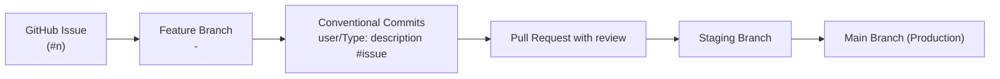
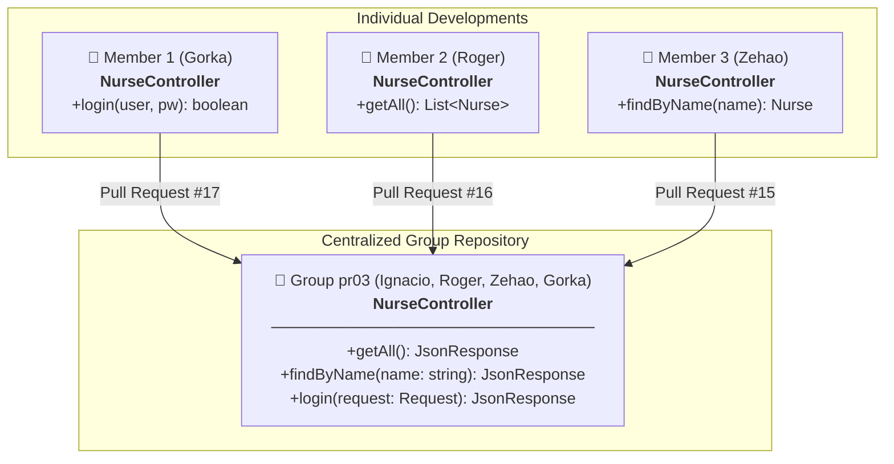
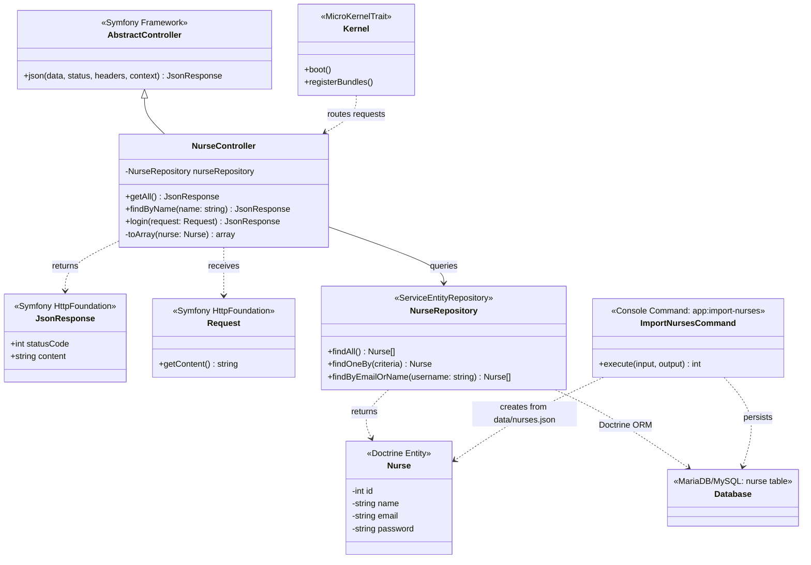
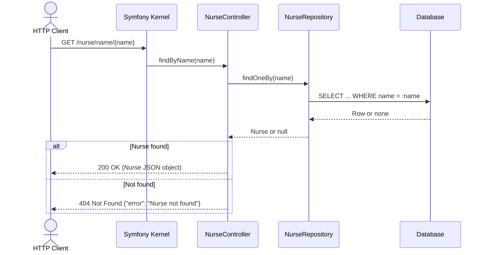
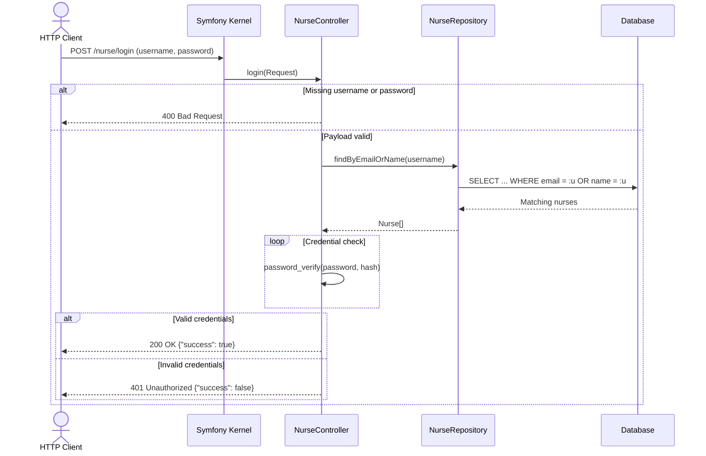
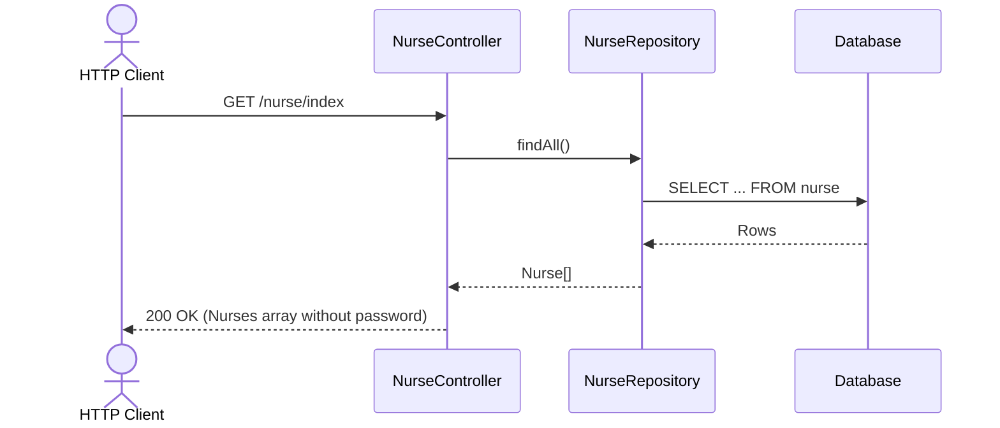
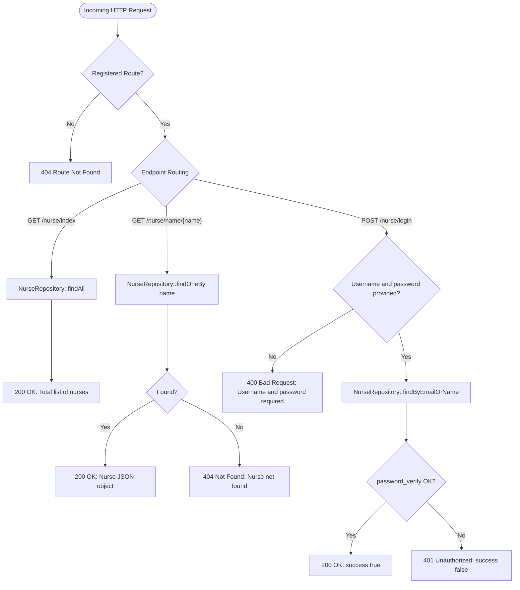

# Nurse Simulator — Comprehensive Project Documentation

> **M0616 - Intermodular Project | DAW 2 (Academic Year 2026/2027)**  
> **Institution:** STUCOM Pelai (Barcelona)  
> **Team:** Group pr03  
> **Authors:** Ignacio Breñas Muñoz, Christopher Roger Tito Farez, Zehao Yin, Gorka Ramirez  
> **Repository:** [https://github.com/Ignaciobrenas/Nurse-Simulator](https://github.com/Ignaciobrenas/Nurse-Simulator)

---

## 1. Executive Summary & Team Roles

**Nurse Simulator** is a RESTful API built with **Symfony 7.4** and **PHP 8.2+** designed to simulate the management of hospital nursing staff.

The project is structured as an academic team endeavor conceived to evolve incrementally across progressive development phases. The API exposes essential web services for querying, searching, and authenticating nurses. In the first phase data was read from a JSON file; in the second phase storage has been migrated to a relational database (MariaDB/MySQL) managed with **Doctrine ORM**.

### Development Team & Roles

| Member | Role | Responsibilities |
|---|---|---|
| **Ignacio Breñas Muñoz** | **Project Manager & Tech Lead** | Overall team organization, feature branch creation for each developer, issue breakdown and assignment in GitHub Projects, Pull Request reviews, and project quality assurance. |
| **Christopher Roger Tito Farez** | **Backend Developer** | Implementation of `GET /nurse/index` endpoint and Postman run evidence. |
| **Zehao Yin** | **Backend Developer** | Implementation of `GET /nurse/name/{name}` endpoint and 1,000 nurses mock dataset expansion. |
| **Gorka Ramirez** | **Backend Developer** | Implementation of `POST /nurse/login` credential validation and Postman test evidence. |

---

## 2. Data Architecture & Storage

The application stores and queries data in a **MariaDB/MySQL** relational database through **Doctrine ORM**:

* **Database:** `nurse_simulator` (`utf8mb4`, collation `utf8mb4_unicode_ci`)
* **Table:** `nurse`, generated from the [`src/Entity/Nurse.php`](../../src/Entity/Nurse.php) entity by a Doctrine migration.
* **Data access:** [`src/Repository/NurseRepository.php`](../../src/Repository/NurseRepository.php)
* **Seed data:** the 1,000 mock records in [`data/nurses.json`](../../data/nurses.json) are loaded into the table with `php bin/console app:import-nurses`.

### Nurse Entity Schema

| Field | DB Type | Constraints | Description |
|---|---|---|---|
| `id` | `INT` | `AUTO_INCREMENT`, primary key | Unique identifier for the nurse |
| `name` | `VARCHAR(100)` | `NOT NULL` | Full name of the nurse |
| `email` | `VARCHAR(180)` | `NOT NULL`, unique (`uniq_nurse_email`) | Contact email address |
| `password` | `VARCHAR(255)` | `NOT NULL` | Hash of the access credential |

> [!NOTE]
> Passwords are stored **hashed** (`password_hash`, bcrypt) and checked with `password_verify`. The API never returns the `password` field in its responses.

---

## 3. Methodology & Git Workflow

The team adopts an agile development methodology supported by **GitHub** collaboration tools:



### Core Workflow Guidelines:
1. **GitHub Projects:** Tasks are tracked on a Kanban board across three columns: `Todo`, `In progress`, and `Done`.
2. **Issues & Branching:** Every feature or bugfix is linked to an *Issue*. Developers create a dedicated branch formatted as:  
   `<issue_number>-<description>`  
   *(Example: `2-implement-read-all-nurses-from-file`)*.
3. **Commit Convention:**  
   `user/Type: description #issue`  
   *(Example: `roger/Feat: implement read all nurses from file #2`)*.
4. **Pull Requests & Code Review:** All branches must go through a peer-reviewed *Pull Request* targeting `staging` before final integration into `main`.

---

## 4. Completed Work & Development Phases

### 4.1. Basic Framework Setup
* Initialized the core project structure on **Symfony 7.4**.
* Configured Composer dependencies via [`composer.json`](file:///C:/Users/Ignacio/Desktop/Nurse-Simulator/composer.json), application lifecycle in [`src/Kernel.php`](file:///C:/Users/Ignacio/Desktop/Nurse-Simulator/src/Kernel.php), and routes in [`config/routes.yaml`](file:///C:/Users/Ignacio/Desktop/Nurse-Simulator/config/routes.yaml).
* Provided a [`.env.example`](file:///C:/Users/Ignacio/Desktop/Nurse-Simulator/.env.example) environment template to protect secrets and facilitate local environment setup.

### 4.2. Read All Nurses From File
* **Branch:** `2-implement-read-all-nurses-from-file`
* **Implementation:** `GET /nurse/index` endpoint inside [`NurseController`](file:///C:/Users/Ignacio/Desktop/Nurse-Simulator/src/Controller/NurseController.php).
* **Logic:**
  1. Verifies the physical existence of [`data/nurses.json`](file:///C:/Users/Ignacio/Desktop/Nurse-Simulator/data/nurses.json). If missing, returns HTTP 500 (`nurses.json not found`).
  2. Reads and parses JSON contents. If invalid or corrupt, returns HTTP 500 (`nurses.json is not valid`).
  3. Returns the complete array of nurse records with HTTP 200 JSON response upon success.

### 4.3. Implement Nurse Login From File
* **Branch:** `3-implement-nurse-login-from-file`
* **Implementation:** `POST /nurse/login` endpoint inside [`NurseController`](file:///C:/Users/Ignacio/Desktop/Nurse-Simulator/src/Controller/NurseController.php).
* **Logic:**
  1. Accepts a JSON request body containing `username` and `password`.
  2. Validates that both fields are supplied. If either is missing, responds with HTTP 400 (`Username and password are required`).
  3. Compares credentials against records in [`data/nurses.json`](file:///C:/Users/Ignacio/Desktop/Nurse-Simulator/data/nurses.json):
     * The `username` field flexibly matches either the **`email`** or the **`name`** field using case-insensitive comparison (`strcasecmp`).
  4. Returns HTTP 200 with `{"success": true}` on matching credentials.
  5. Returns HTTP 401 Unauthorized with `{"success": false}` if credentials do not match.

### 4.4. Find Nurse By Name From File
* **Branch:** `4-implement-find-nurse-by-name-from-file`
* **Implementation:** `GET /nurse/name/{name}` endpoint inside [`NurseController`](file:///C:/Users/Ignacio/Desktop/Nurse-Simulator/src/Controller/NurseController.php).
* **Logic:**
  1. Extracts `{name}` from the route parameters.
  2. Iterates over the records, comparing names case-insensitively (`strcasecmp`).
  3. Returns HTTP 200 with the matching nurse object if found.
  4. Returns HTTP 404 with `{"error": "Nurse not found"}` if no matching record exists.
  5. Expanded the mock dataset to 1,000 nurses in this phase to stress-test retrieval.

### 4.5. Database Migration with Doctrine ORM
* **Branches:** `38-setup-doctrine-orm-and-nurse-entity` and `39-move-nurses-to-database`
* **Implementation:**
  1. Installed **Doctrine ORM** and **Doctrine Migrations**. The connection is set in `.env.local` through `DATABASE_URL`, which is not committed.
  2. Created the [`Nurse`](../../src/Entity/Nurse.php) entity, its [`NurseRepository`](../../src/Repository/NurseRepository.php) and the migration that creates the `nurse` table. Tables default to InnoDB and `utf8mb4_unicode_ci` ([`config/packages/doctrine.yaml`](../../config/packages/doctrine.yaml)).
  3. [`app:import-nurses`](../../src/Command/ImportNursesCommand.php) command: imports the nurses from `data/nurses.json`, hashing their passwords. It skips emails that already exist, so it can be run repeatedly without duplicating data.
  4. [`NurseController`](../../src/Controller/NurseController.php) no longer reads the JSON file and queries the database through `NurseRepository`. Routes and status codes are unchanged, except:
     * Responses no longer include the `password` field.
     * `GET /nurse/index` no longer returns the `nurses.json` 500 errors.
  5. Name search and login remain case-insensitive on `name` and `email` thanks to the `utf8mb4_unicode_ci` collation. Passwords are case-sensitive.
* **Comparison with the expected model:** `doctrine:schema:validate` confirms the database is in sync with the entity. The only difference from the expected SQL is the `doctrine_migration_versions` table, which Doctrine Migrations uses to record executed migrations.

---

## 5. API Specification & Endpoints

### Endpoint Summary

| Method | Endpoint | Parameters | Expected Responses |
|---|---|---|---|
| `GET` | `/nurse/index` | None | `200 OK`: Array of all nurses (`id`, `name`, `email`) |
| `GET` | `/nurse/name/{name}` | Path param: `name` (string) | `200 OK`: Nurse object (`id`, `name`, `email`)<br>`404 Not Found`: `{ "error": "Nurse not found" }` |
| `POST` | `/nurse/login` | JSON Body: `username`, `password` | `200 OK`: `{ "success": true }`<br>`400 Bad Request`: Missing credentials<br>`401 Unauthorized`: `{ "success": false }` |

### Request and Response Examples

#### 1. Retrieve all nurses
```bash
curl -X GET http://localhost:8000/nurse/index
```
**Response (HTTP 200):**
```json
[
  {
    "id": 1,
    "name": "Ana",
    "email": "ana@hospital.com"
  },
  {
    "id": 2,
    "name": "Carlos",
    "email": "carlos@hospital.com"
  }
]
```

#### 2. Search nurse by name
```bash
curl -X GET http://localhost:8000/nurse/name/Ana
```
**Response (HTTP 200):**
```json
{
  "id": 1,
  "name": "Ana",
  "email": "ana@hospital.com"
}
```
**Error Response (HTTP 404):**
```json
{
  "error": "Nurse not found"
}
```

#### 3. Nurse login
```bash
curl -X POST http://localhost:8000/nurse/login \
  -H "Content-Type: application/json" \
  -d '{"username": "ana@hospital.com", "password": "ana123"}'
```
**Success Response (HTTP 200):**
```json
{
  "success": true
}
```
**Unauthorized Response (HTTP 401):**
```json
{
  "success": false
}
```
**Missing Fields Response (HTTP 400):**
```json
{
  "success": false,
  "message": "Username and password are required"
}
```

---

## 6. Architecture, UML Schemas & Flowcharts

### 6.1. Modular Integration Schema (Individual Development to Group Repository)

Based on the official intermodular assignment guidelines (`pr03_Introduccio_back_end`), each developer implemented their endpoint method individually before coordinated merging into the centralized group repository:



### 6.2. UML Class Diagram

Representation of the application classes and relationships built on Symfony 7.4:



### 6.3. Sequence Diagram: Search Nurse by Name



### 6.4. Sequence Diagram: Nurse Login



### 6.5. Sequence Diagram: Read All Nurses



### 6.6. Application Logic Flowchart



---

## 7. Testing & Postman Collection

A dedicated **Postman** collection with verified request templates and test evidence is available in:
* [`docs/postman/nurse-api.postman_collection.json`](file:///C:/Users/Ignacio/Desktop/Nurse-Simulator/docs/postman/nurse-api.postman_collection.json)

The collection includes organized subfolders mirroring test executions:
* [`docs/postman/readAll`](file:///C:/Users/Ignacio/Desktop/Nurse-Simulator/docs/postman/readAll): Tests for `/nurse/index`.
* [`docs/postman/readByName`](file:///C:/Users/Ignacio/Desktop/Nurse-Simulator/docs/postman/readByName): Tests for `/nurse/name/{name}` covering 200 and 404 statuses.
* [`docs/postman/login`](file:///C:/Users/Ignacio/Desktop/Nurse-Simulator/docs/postman/login): Tests for `/nurse/login` covering 200, 400, and 401 statuses.

---

## 8. Project Structure

```
Nurse-Simulator/
├── bin/
│   └── console                     # Symfony CLI tool
├── config/                         # Configuration files (routes, packages, services)
│   ├── packages/
│   ├── routes.yaml
│   └── services.yaml
├── data/
│   └── nurses.json                 # Seed dataset (1,000 nurses) for app:import-nurses
├── docs/                           # Documentation directory
│   ├── general/
│   │   ├── DOCUMENTACION_ES.md     # Full Spanish documentation
│   │   ├── DOCUMENTATION_EN.md     # Full English documentation
│   │   ├── Nurse-Simulator.docx    # Project report document
│   │   └── Nurse-Simulator_...pdf  # Official academic report (PDF)
│   └── postman/                    # Postman collection and run evidence
│       ├── login/
│       ├── readAll/
│       ├── readByName/
│       └── nurse-api.postman_collection.json
├── migrations/                     # Doctrine migrations (creates the nurse table)
├── public/
│   └── index.php                   # Web application entry point (Front Controller)
├── src/
│   ├── Command/
│   │   └── ImportNursesCommand.php # app:import-nurses command
│   ├── Controller/
│   │   └── NurseController.php     # Controller handling nurse endpoints
│   ├── Entity/
│   │   └── Nurse.php               # Doctrine entity (nurse table)
│   ├── Repository/
│   │   └── NurseRepository.php     # Nurse queries
│   └── Kernel.php                  # Symfony application kernel
├── .env.example                    # Environment configuration template
├── composer.json                   # PHP dependencies and autoload definitions
├── README.md                       # Quick start guide
└── LICENSE                         # Project license
```

---

## 9. Installation & Local Execution

### Prerequisites
* **PHP** >= 8.2 (with `mbstring`, `json`, `ctype`, etc.)
* **Composer** >= 2.0
* **MariaDB** or **MySQL** (for example, the one bundled with XAMPP)
* *(Optional)* **Symfony CLI**

### Setup Instructions

1. **Clone the repository:**
   ```bash
   git clone https://github.com/Ignaciobrenas/Nurse-Simulator.git
   cd Nurse-Simulator
   ```

2. **Install dependencies:**
   ```bash
   composer install
   ```

3. **Configure environment:**
   ```bash
   cp .env.example .env
   ```
   Add the database connection to `.env.local` (not committed). `serverVersion` must match your server (`SELECT VERSION();`):
   ```dotenv
   # XAMPP (MariaDB)
   DATABASE_URL="mysql://root:@127.0.0.1:3306/nurse_simulator?serverVersion=10.4.32-MariaDB&charset=utf8mb4"
   ```

4. **Create the database and load the data:**
   ```bash
   php bin/console doctrine:database:create
   php bin/console doctrine:migrations:migrate
   php bin/console app:import-nurses
   ```
   The import takes about a minute because it hashes all 1,000 passwords.

5. **Launch the development server:**
   * Using Symfony CLI:
     ```bash
     symfony server:start
     ```
   * Or with PHP's built-in server:
     ```bash
     php -S localhost:8000 -t public
     ```

6. **Inspect registered routes:**
   ```bash
   php bin/console debug:router
   ```

---

## 10. Roadmap & Upcoming Milestones

The following architectural enhancements are scheduled for upcoming phases:

1. ~~**Persistence & Repository Layer:** `NurseRepository`.~~ ✅ Done in phase 4.5.
2. ~~**Relational Database:** migrate from JSON to **Doctrine ORM** with migrations.~~ ✅ Done in phase 4.5.
3. **Security & Hashing:** ✅ Passwords are now hashed. Pending: authentication tokens (JWT / sessions).
4. **Data validation:** Add Symfony Validator constraints to the `Nurse` entity.
5. **Automated Testing:** Integrate unit and end-to-end integration test suites with PHPUnit and Symfony's `WebTestCase`.
